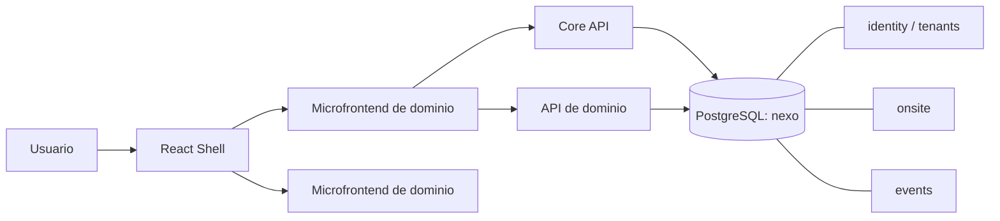

# Nexo Integration Architecture Spine

## Paradigm

**Modular monolith frontend + microservices por bounded context, gobernados por contratos.** El shell web integra microfrontends locales hoy y mantiene el límite para cargarlos como remotes en el futuro. Los servicios son dueños de sus schemas y se comunican por APIs/eventos, no por acceso directo a datos privados.

## Inherited Invariants

- La plataforma Nexo y HukID son sistemas distintos; HukID no comparte la base de Nexo.
- Nexo consolida sus microservicios en una base PostgreSQL lógica `nexo`, aislada mediante schemas por bounded context.

## Architecture Decisions

### AD-1 — Shell como plataforma de integración [ADOPTED]

**Binds:** `frontend/src/shell`, `frontend/src/platform`, `ModuleContext`, sesión, tenant, router, sidebar, i18n y design system.

**Prevents:** que cada equipo cree navegación, sesión, tokens visuales o contexto de tenant incompatibles.

**Rule:** los módulos reciben `ModuleContext` versionado, se registran con `MicrofrontendManifest` y no importan internals de otro módulo. El shell resuelve y niega rutas directamente desde el registry filtrado por capabilities.

### AD-2 — Namespaces y propiedad explícita [ADOPTED]

**Binds:** `id`, ruta, capability, carpeta de módulo, contrato API y schema de cada capacidad.

**Prevents:** colisiones de rutas, permisos ambiguos y cambios sin dueño.

**Rule:** una capacidad tiene un namespace de ruta, un manifest, un dueño y un schema. Las rutas de otro módulo y las tablas privadas son límites prohibidos.

### AD-3 — Gitflow ligero con gates automáticos [ADOPTED]

**Binds:** ramas, PRs y merges.

**Prevents:** integración directa de cambios sin revisión o sin pruebas.

**Rule:** `main` es estable, `develop` integra; todo trabajo vive en ramas `feature/`, `fix/`, `chore/`, `docs/`, `release/` u `hotfix/`. El merge requiere CI verde y revisión. Hasta conectar GitHub, esta regla se aplica por proceso; al conectar `origin`, el ruleset descrito en `GITHUB-REPOSITORY-SETUP.md` la vuelve obligatoria.

### AD-4 — Fixtures aislados y contratos compatibles [ADOPTED]

**Binds:** seeds, fixtures, pruebas E2E, OpenAPI y eventos.

**Prevents:** que un equipo rompa flujos de otro alterando datos o payloads compartidos.

**Rule:** fixtures del módulo son privadas; las compartidas son aditivas y con IDs estables. Cambios incompatibles usan versión o deprecación.

### AD-5 — PostgreSQL único con schemas por dominio [ADOPTED]

**Binds:** `nexo`, schemas, migraciones y repositorios.

**Prevents:** duplicidad de bases, acoplamiento entre tablas y ownership confuso.

**Rule:** cada servicio sólo migra y consulta su schema, con rol propio y tabla de metadata de migraciones exclusiva dentro de `platform_meta`. Las reglas entre dominios se resuelven con APIs/eventos o proyecciones explícitas.

### AD-6 — Registry validado como único punto de montaje [ADOPTED]

**Binds:** `MicrofrontendManifest`, `moduleRegistry`, rutas, capabilities y pruebas del shell.

**Prevents:** módulos inaccesibles, rutas duplicadas y acceso directo a módulos no autorizados.

**Rule:** cada módulo declara `id`, rutas, ruta por defecto y capabilities en el registry; `validateRegistry()` debe permanecer verde y el shell carga sólo el módulo autorizado que resuelve la ruta.

### AD-7 — Gates verificables y límites declarados [ADOPTED]

**Binds:** CI, contratos, pruebas E2E, fixtures y migraciones.

**Prevents:** que un checklist manual suplante una verificación disponible o que una limitación transitoria se presente como protección técnica.

**Rule:** CI ejecuta build, tests, E2E, validación sintáctica de OpenAPI y pruebas de los servicios. Los gates semánticos OpenAPI, branch protection y consolidación de PostgreSQL se mantienen explícitamente bloqueados/deferred hasta que exista su automatización.

## Seed

- Frontend: React/Vite, `ModuleContext`, registry local y design system existente.
- Backend: Go/Fiber, arquitectura hexagonal y OpenAPI por servicio.
- Verificación: build, unit tests, validación sintáctica de OpenAPI, E2E de flujos transversales y `make test` para servicios con PostgreSQL.

## Deferred

- Sustituir los imports locales de microfrontends por remotes/Module Federation cuando exista una necesidad real de despliegue independiente.
- Implementar la consolidación física de `nexo_onsite` dentro de la base `nexo` y su schema `onsite`.
- Configurar rulesets, required checks y Code Owners reales en GitHub cuando se conecte el remoto.
- Automatizar un diff semántico de OpenAPI y validación `up → down → up` de las migraciones antes de permitir APIs de otros equipos.
- Publicar el cliente HTTP autenticado y refresh coordinado desde Core API antes de considerar integraciones de dominio listas para producción.
