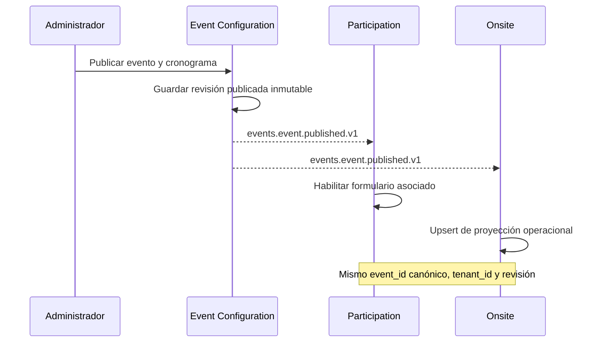
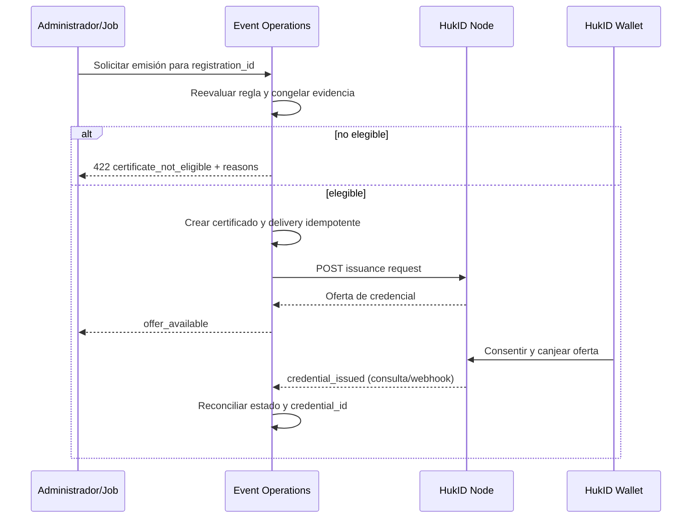

# Flujos y modelos de estado

## 1. Actores

| Actor | Responsabilidad |
|---|---|
| Participante | Completa el formulario, conserva su ticket y acepta o rechaza recibir credenciales HukID. |
| Operador | Consulta el padrón y ejecuta check-in/check-out. |
| Supervisor | Puede anular hechos de asistencia con una razón obligatoria. |
| Administrador | Configura eventos, reglas de asistencia y solicita emisiones. |
| Participation | Valida formulario, deduplica, registra y coordina la credencial de entrada. |
| Onsite | Mantiene la proyección operacional del evento y su asistencia efectiva. |
| Event Operations | Evalúa elegibilidad y coordina la credencial-certificado. |
| HukID | Emite, entrega y mantiene el estado de credenciales verificables. |

## 2. Publicación y propagación de un evento



Una actualización posterior emite `events.event.schedule.updated.v1`. Participation y Onsite deben aceptar replay e ignorar una revisión más antigua.

## 3. Registro y deduplicación

### 3.1 Identidad mínima

La identidad de inscripción será:

```text
(tenant_id, form_id, email_normalized)
```

`email_normalized` se obtiene antes de consultar o insertar:

- quitar espacios exteriores;
- convertir a minúsculas Unicode de forma estable;
- validar formato;
- no aplicar transformaciones específicas de proveedores como eliminar puntos de Gmail.

También se calcula un `participant_fingerprint` con campos normalizados configurados por el formulario. Este fingerprint solo genera una señal de revisión; no bloquea automáticamente homónimos.

### 3.2 Semántica idempotente

| Situación | Resultado |
|---|---|
| Misma `Idempotency-Key` y mismo hash canónico | Reproducir la respuesta original; no insertar ni emitir otra credencial. |
| Misma key y payload distinto | `409 idempotency_key_reused`. |
| Key distinta, mismo correo normalizado y formulario | `409 already_registered`; no emitir otro ticket. |
| Dos solicitudes concurrentes iguales | Una crea el registro; la otra reproduce o recibe conflicto determinista. |
| Registro previo cancelado y política permite reinscripción | Crear nueva versión enlazada al registro anterior, nunca sobrescribirlo. |

La respuesta `already_registered` no devuelve tokens, QR ni datos privados del registro existente. Debe ofrecer un flujo seguro para recuperar el ticket mediante verificación de posesión del correo.

## 4. Padrón operacional

Un participante confirmado debe aparecer en Onsite antes de llegar al evento. El padrón combina la proyección de Participation con la asistencia efectiva.

### 4.1 Estados del padrón

```text
registered/confirmed ──check-in──> present ──checkout──> checked_out
        │                    │                         │
        ├──cancelación──────> cancelled               │
        └──fin sin check-in─> no_show                 │
                             │                         │
                       void/recompute <───────────────┘
```

Definiciones:

- `confirmed`: registro confirmado y ticket vigente, sin presencia efectiva.
- `present`: existe check-in efectivo no compensado y no existe checkout posterior efectivo.
- `checked_out`: existe checkout efectivo posterior al check-in.
- `no_show`: el evento terminó y nunca existió check-in efectivo.
- `cancelled`: registro cancelado o ticket revocado.

El estado `no_show` se deriva; no se escribe manualmente.

## 5. Asistencia append-only

- `check_in`, `check_out` y `void` crean hechos nuevos.
- Un void referencia el hecho compensado y exige razón, actor y scope `onsite:void`.
- Un checkout exige presencia efectiva.
- Dos check-ins concurrentes no pueden dejar dos presencias efectivas.
- Al aceptar un hecho, Onsite actualiza su read model en la misma transacción y publica `onsite.attendance.changed.v1` mediante outbox.
- Un ticket HukID verificado se resuelve a un `ticket_id` interno; los claims no se usan como sustituto de la autorización o del estado actual.

## 6. Elegibilidad del certificado

La regla publicada es inmutable y versionada. La versión inicial exige:

1. registro confirmado;
2. evento publicado y finalizado (`now >= ends_at`);
3. al menos un check-in efectivo;
4. registro y asistencia del mismo tenant y evento;
5. certificado activo inexistente para la misma regla;
6. consentimiento HukID vigente al solicitar la entrega.

Campos extensibles:

- `minimum_sessions_attended`;
- `minimum_attendance_ratio`;
- `required_session_ids`;
- `require_checkout`;
- `issuance_mode`: `manual` o `automatic`.

La evaluación devuelve razones explícitas: `event_not_finished`, `registration_not_confirmed`, `attendance_missing`, `required_sessions_missing`, `attendance_ratio_insufficient`, `certificate_already_exists`, `consent_missing`.

## 7. Emisión hacia HukID



La evidencia congelada incluye regla/versión, evento, asistencia efectiva, hash canónico y timestamps. Un cambio posterior no modifica el certificado ya emitido; requiere revocación y reemplazo.

## 8. UX requerida

- El selector de evento carga eventos operables del tenant y recuerda la selección por usuario y tenant.
- La tabla de asistencia carga el padrón completo, no solo los check-ins.
- Columnas mínimas: participante, código de registro/ticket, estado, hora de entrada, hora de salida, elegibilidad y acciones autorizadas.
- El filtro permite `Todos`, `Confirmados`, `Presentes`, `Salieron`, `Ausentes` y `Cancelados`.
- El botón de certificado solo se habilita cuando `eligible=true`; si no, muestra las razones.
- La oferta HukID se presenta únicamente mientras sea válida y se actualiza por reconciliación.
- Todo el contenido existe en ES/EN y utiliza el sistema de diseño.

